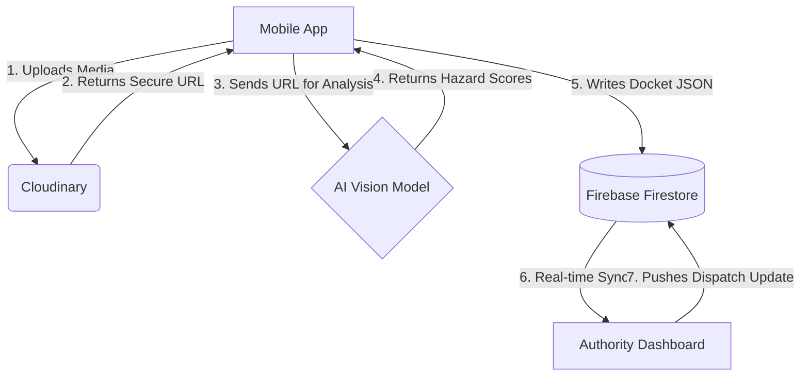

#  Hazard Lens: AI-Powered Infrastructure Inspection & Reporting

A mobile-first enterprise hazard reporting system built during an industrial internship at the Customer Care (CC) Department, APDCL. Designed for field staff and local users, the platform captures media of suspected infrastructure hazards, uses an AI vision model guided via few-shot, in-context prompting to evaluate severity, tags the data with precise GPS coordinates, and routes actionable "dockets" to a live authority dashboard for immediate dispatch.

##  Overview

The core premise of Hazard Lens is to empower users to easily report major electrical and infrastructure hazards in their local surroundings. While users can track the details of their own submitted complaints, the primary objective of the platform is to dramatically reduce the workload and stress at the authority end.

Traditional complaint management often leaves dispatchers guessing about the true nature of an issue. Hazard Lens solves this by automating the categorization and severity assessment of every incoming report. Instead of manually sorting through vague phone calls or text messages, authority staff can instantly see if a case is a severe emergency or a normal-priority maintenance task, allowing them to triage and prioritize hazard resolution efficiently.

When a complaint arrives at the live dashboard, dispatchers are equipped with a complete visual breakdown of the hazard. They receive precise GPS location data pinpointing exactly where the complaint was sent from, alongside rich photo and video evidence. This comprehensive media payload gives the control room a perfect manual understanding of the technical issue on the ground before a repair team is even dispatched.

The ecosystem consists of two decoupled clients:

- **Mobile App (React Native / Expo)** — the primary data-collection tool used to capture media and submit reports.
- **Authority Dashboard (Web)** — a centralized dispatch console used by APDCL Customer Care to review visual evidence, assess AI diagnostics, and assign repair crews.

##  System Features

###  Mobile Field Application

- **Secure Authentication** — Role-based login and registration handled securely via Firebase Authentication.
- **Optimized Media Handling** — Camera capture for both photo and video evidence is seamlessly integrated. Heavy media files are directly offloaded to Cloudinary, compressing them on the fly to prevent database bloat and ensure fast uploads on weak mobile networks.
- **Geospatial Tagging** — Automatic extraction and embedding of device GPS coordinates to pinpoint the exact location of the compromised utility pole.
- **AI Diagnostics** — Integration with the Gemini Vision API, guided via few-shot in-context prompting, to detect hazards across 5 distinct categories, providing deterministic, per-category severity scoring.
- **Structured Dockets** — Uniquely identified, standardized report submissions that eliminate messy, unstructured data entry.

###  Authority Dispatch Dashboard

- **Live Operational Queue** — A real-time, time-ordered feed of incoming hazard dockets that updates instantly without requiring page refreshes.
- **Expanded Forensic Views** — Deep-dive panels for each docket revealing status timelines, high-resolution photo/video evidence, AI diagnostic results, and original field notes.
- **Dispatch & Audit Trail** — A dispatch panel allowing supervisors to push status updates (assigning employee IDs, offices, teams, and remarks). Every action is logged sequentially, creating a fully immutable audit trail for every reported hazard.

##  System Architecture

The platform utilizes a modern Backend-as-a-Service (BaaS) architecture. Both the mobile and web clients communicate directly with Firebase and Cloudinary, eliminating the need to host and maintain a custom middleware server.

The mobile app offloads heavy media to Cloudinary, sends the resulting secure URL to the AI model for analysis, and writes the final structured JSON report to Firestore. The dashboard reads from this exact same collection, appending dispatch updates to the docket's history array rather than overwriting it, ensuring a pristine operational log.

##  Why Firebase (BaaS) Instead of a Custom Backend

A more traditional stack was considered during the initial design phase — a custom REST API (Node.js or Python/FastAPI) backed by a database like MongoDB or PostgreSQL, similar to other internal APDCL projects. That approach offers more flexibility for complex relational data and a fully custom API surface, but it also means building and maintaining your own auth system, writing CRUD endpoints for every resource, and hosting a server — overhead that would have eaten into a one-month timeline better spent on the actual hazard-detection pipeline.

Firebase (Firestore + Auth) was chosen instead because it's a managed Backend-as-a-Service:

- **No custom server to write, deploy, or maintain** — Firestore and Auth are hosted and scale automatically.
- **Real-time sync is built in.** The live dashboard queue updates instantly via Firestore's `onSnapshot` listeners, which would otherwise require building a WebSocket layer from scratch.
- **Authentication comes out of the box** — sessions, tokens, and password hashing are handled by Firebase rather than implemented and secured manually.

The trade-off is less flexibility for complex relational queries and tighter coupling to Firebase's own query model. For a focused, single-purpose MVP built in a month, that trade-off favored speed and reliability over long-term architectural flexibility — migrating to a custom microservices backend with a relational database is a natural next step if the platform scales beyond its current use case.

##  AI Architecture & Prompt Design

To achieve high accuracy in infrastructure hazard detection, Hazard Lens leverages a foundation vision model (Gemini) that is guided, through structured few-shot prompting, to evaluate utility-specific hazard cases. This approach to AI engineering was chosen for several critical reasons:

**In-Context Prompting and Adaptation.** Rather than relying solely on the AI's general knowledge, the model is guided using specific hazard definitions. For each of the five hazard categories, a small set of reference photographs — real examples of fire hazards, exposed wires, sagging feeders, damaged poles, and water logging — was compiled and included directly in the prompt sent to Gemini, alongside written criteria describing what separates a Clear case from a Severe one within each category (e.g., illustrating the visual difference between a "sagging feeder" and standard wire slack). This combination of example images and explicit scoring criteria is what lets the model make consistent, apples-to-apples severity judgments across categories — a technique known as few-shot, in-context prompting.

**Overcoming the "Cold Start" Data Problem.** Training a legacy classification model (like ResNet or YOLO) from absolute scratch requires tens of thousands of highly annotated photos. By starting with a state-of-the-art foundation model and guiding it with targeted, few-shot reference examples, high accuracy was achieved within the one-month internship timeline.

**Environmental Robustness.** Field photography is inherently messy. Because the base foundation model already understands the real world, the guided hazard-detection pipeline easily handles visual noise — such as sun glare, rain, poor camera angles, and low resolution — far better than a small-scale custom model would.

**System Orchestration & Data Parsing.** The core engineering challenge was not just prompting the model to recognize hazards, but orchestrating its output for a database. The pipeline was engineered to force the AI to return deterministic, parseable JSON scores based on the visual reference cases, allowing the unstructured photo to be converted into structured database metrics instantly.

##  Tech Stack

| Layer | Technology | Purpose in System |
|---|---|---|
| Mobile Frontend | React Native (Expo) | Provides a responsive, cross-platform mobile UI for field operations. |
| Authentication | Firebase Auth | Manages secure user sessions, JWTs, and credential storage. |
| Data Store | Firebase Firestore | A highly scalable NoSQL database handling real-time data synchronization. |
| Media Storage | Cloudinary | Automatically compresses and hosts heavy photos and videos to maintain database agility. |
| AI Analysis | Gemini Vision API | Guided via few-shot, in-context prompting for automated hazard identification and severity scoring. |
| Hardware APIs | Expo Location & Camera | Accesses native device sensors for GPS tagging and media capture. |
| Web Dashboard | HTML, Tailwind CSS, Vanilla JS | Delivers a lightweight, rapid-deployment dispatch portal for supervisors. |

##  Scope & Path to a Production Version

Hazard Lens was built end-to-end within a one-month internship, so the priority was proving the concept — capture, AI-assessed severity, GPS tagging, and a live authority dashboard — rather than building production-grade infrastructure from scratch. The tools chosen (Firebase, Cloudinary, prompt-based AI) were selected specifically because they let a small, focused feature set go from idea to a working app quickly, without needing to build and secure a full backend in the available time.

A production deployment of this system, given more time and resources, would reasonably invest in:

- **A custom-built authentication service** — moving beyond Firebase Auth to a dedicated login/identity system with organization-specific role management (e.g. tiered access for dispatchers, field supervisors, and administrators).
- **A custom, self-managed database** — a relational or purpose-built data store with a dedicated backend API, offering more control over data modeling, indexing, and complex queries than Firestore's document model allows.
- **A fine-tuned or purpose-trained vision model** — rather than guiding a foundation model via few-shot prompting, a production system with access to a large labeled dataset of utility-specific hazard imagery could train or fine-tune a dedicated model, potentially improving accuracy and reducing per-request cost at scale.
- Additional production concerns such as load testing, monitoring and alerting, automated CI/CD pipelines, and a formal security audit.

In short: this repository is a functional prototype demonstrating the core idea end-to-end, built deliberately with fast, managed tools under a real time constraint — not a finished production system.
